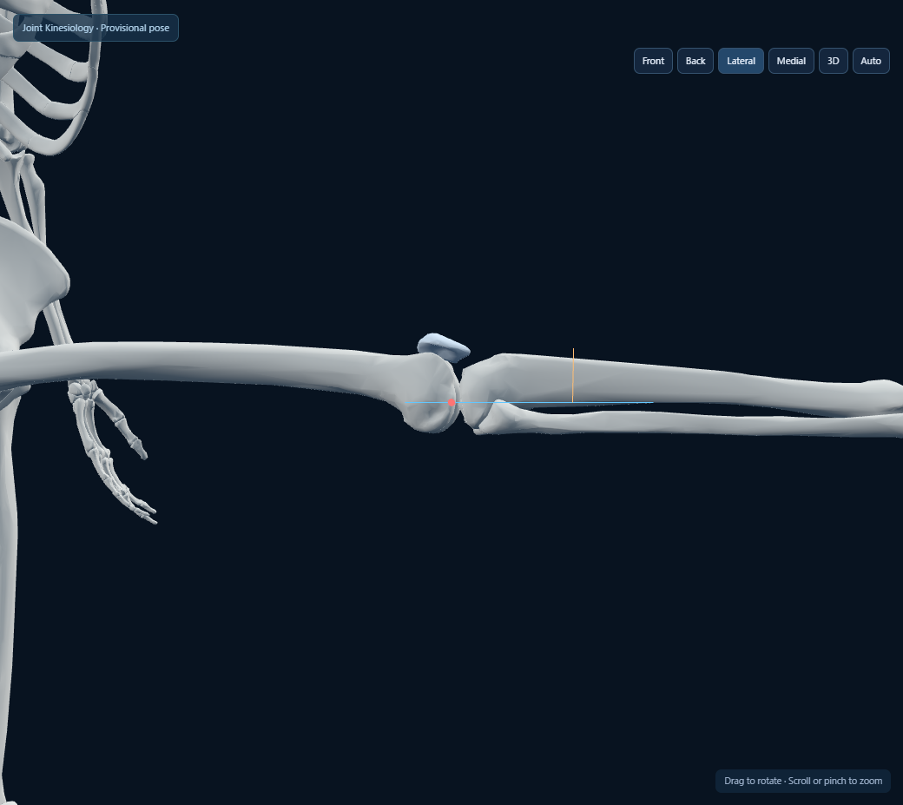
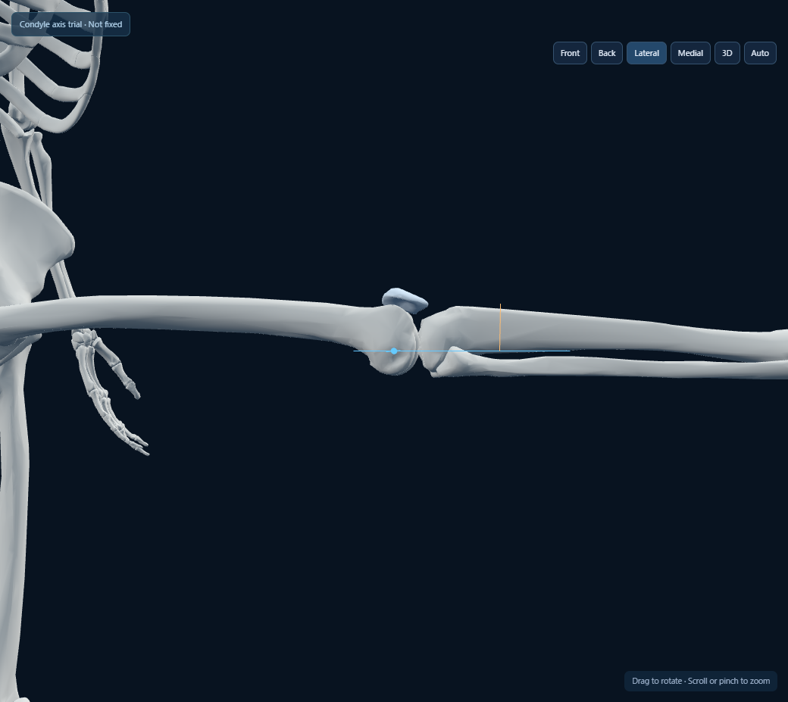
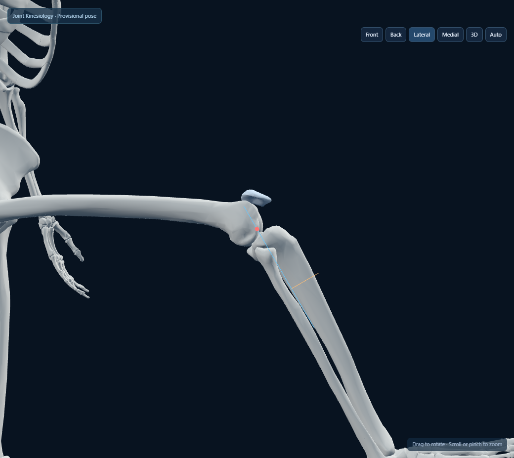
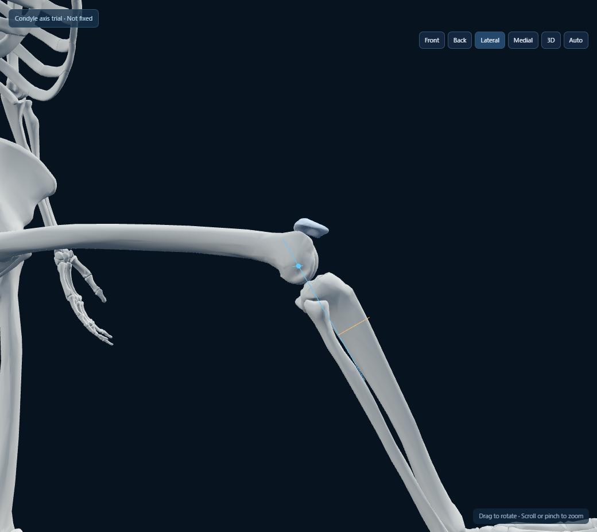
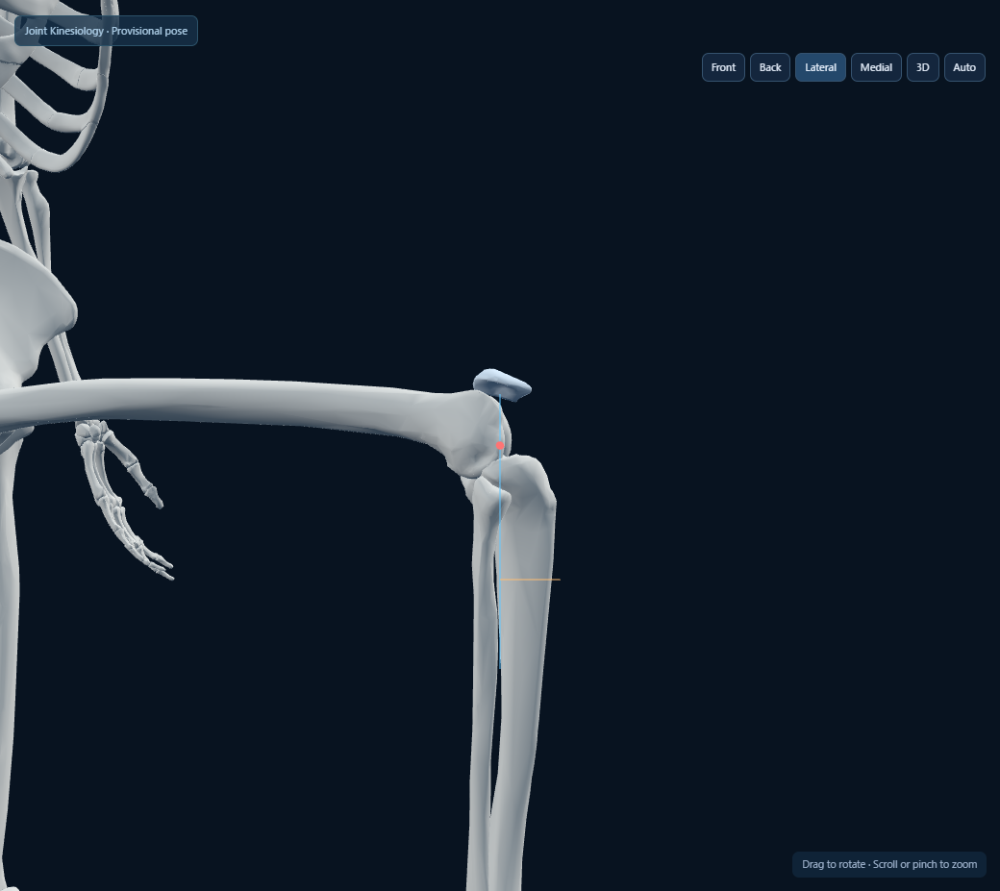
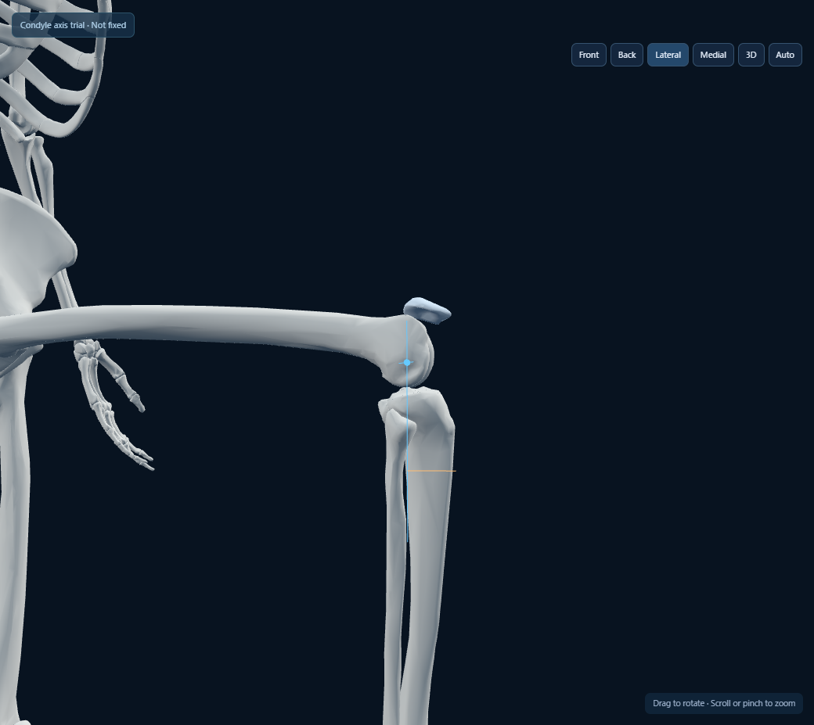
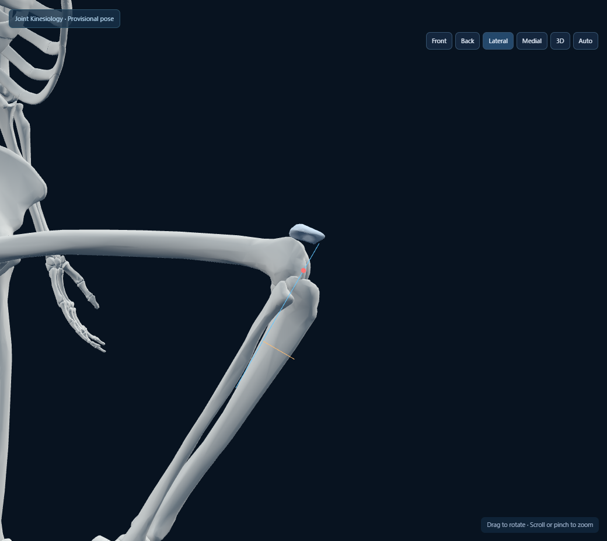
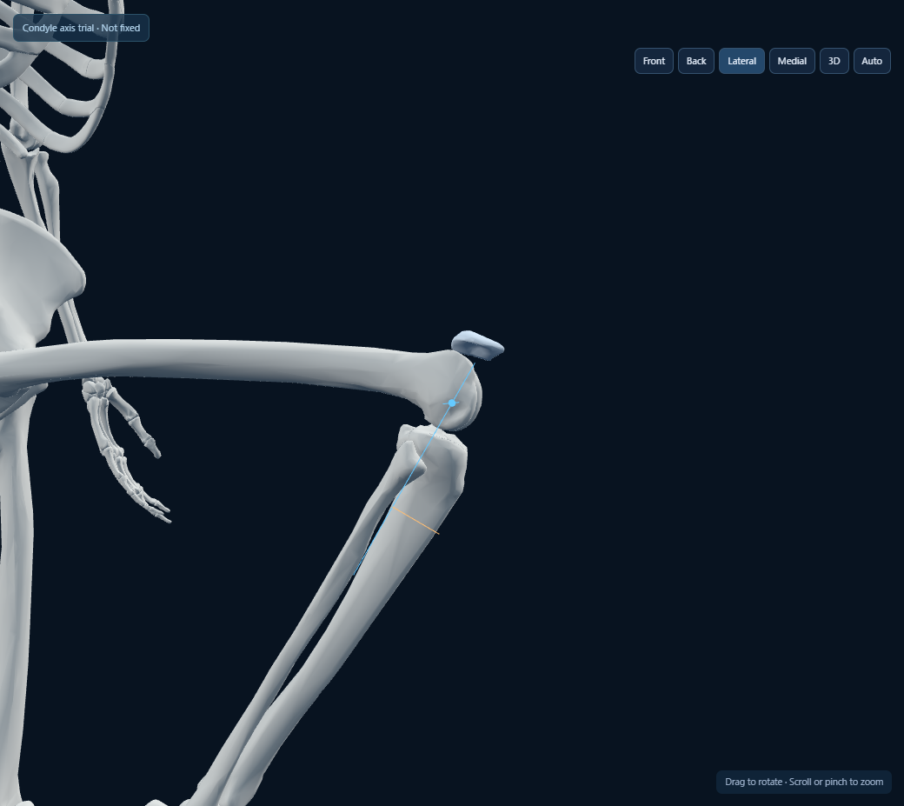
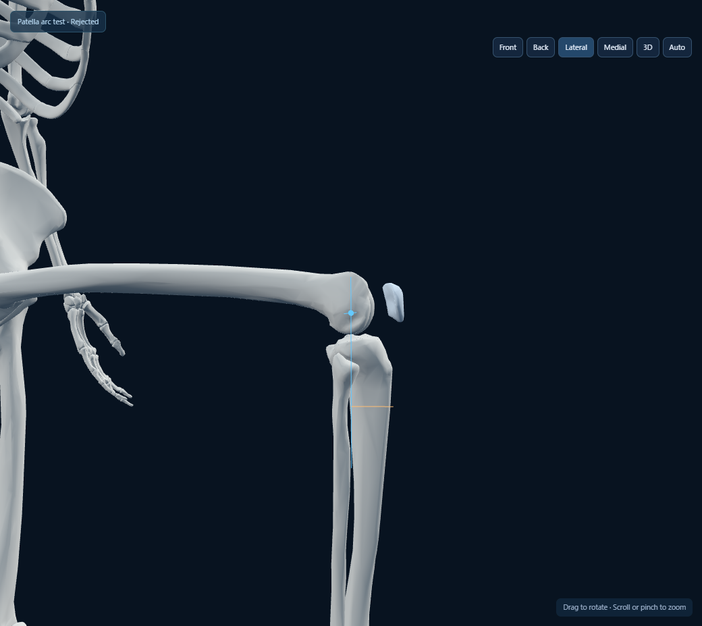

# 屈伸軸・膝蓋骨の比較検証

> これは固定軸比較時点の記録。現在は角度依存の回転＋並進と移動軸を実装済み。[後続記録](ROLL_SLIDE_REVIEW.md) を参照。旧固定軸挙動の再現には `&motion=fixed` を指定する。

2026-10-30。ユーザー指摘: 現行回転軸がずれ、膝蓋骨の動きが不十分。最初に屈伸の中心から比較し、候補の向きも併せて可視化します。筋・靭帯・半月板の追加開発は行いません。

## 動作する比較画面

- 現行: `http://127.0.0.1:8080/?review=knee`
- 軸の比較候補: `http://127.0.0.1:8080/?review=knee&axis=condyle`

Auto/Pause、角度、視点、既存の軸表示を共用。赤は現行、青は顆部近似による軸候補です。候補は明示的なquery付きの骨格検証画面にだけ適用し、通常版・現行検証画面の中心/軸は変更していません。候補をFIX済みとは扱いません。

## 屈伸軸の比較候補

大腿骨2020頂点から、遠位10%、後方40%の範囲を抽出。顆間部を横幅12%で除外し、内側・外側のそれぞれに最小二乗球面を近似。2球の中心を結ぶ線を屈伸軸候補、その中点をピボット候補としました。この領域は幾何学的な切り出しで、専門家が関節面を注釈したものではありません。

後方顆の中心を結ぶ軸を比較対象にする考え方は実験研究にあります。ただし、形状からの軸がそのまま対象の機能軸になると保証するものではありません。[The transepicondylar axis approximates the optimal flexion axis of the knee](https://pubmed.ncbi.nlm.nih.gov/9917674/)、[Identifying the Functional Flexion-extension Axis of the Knee](https://pubmed.ncbi.nlm.nih.gov/26039711/)

| 項目 | 現行 | 比較候補 |
|---|---|---|
| 中心（GLBシーン座標） | (-0.076043, 0.438329, -0.034491) | (-0.073630, 0.453997, -0.036618) |
| 屈伸軸の単位ベクトル | (1, 0, 0) | (0.998404, -0.056186, 0.005672) |
| 中心移動量 | — | +X 0.002413、+Y 0.015668、−Z 0.002127 |
| 位置差 / 方向差 | — | 約0.015994シーン単位 / 3.237° |

GLBをm単位として扱う本モデルでは、約16mmの位置差、うち近位方向は約15.7mmに相当します。内側194点・半径0.021205・半径方向RMS残差0.001886、外側188点・半径0.019915・RMS残差0.001998です。残差約1.9〜2.0mm相当は**軸位置の精度を保証する値ではありません**。頂点は等重みで面積補正せず、ROIの取り方と低分解能メッシュに依存します。

内外旋・内外反の軸は今回変更せず、屈伸軸の変更だけを切り分けています。転がり・滑り・接触点移動は未実装のため、候補でも骨運動の妥当性を承認していません。

## 同一角度・右外側からの比較

| 屈曲 | 現行中心・軸 | 顆部近似の候補 |
|---|---|---|
| 0° |  |  |
| 60° |  |  |
| 90° |  |  |
| 120° |  |  |

30°を含む全比較データは [condyle-patella-trial.json](condyle-patella-trial.json)。位置と向きは、側面だけでなくカメラを回して顆部との対応を確認する必要があります。

## 膝蓋骨: 現行は不足、単純円弧案も不採用

現行コードは膝蓋骨群を下方にわずかに直線移動するだけで、膝蓋骨自体の回転を与えていません。これでは膝の屈伸に対する位置・向きの変化が不足します。

比較のため、上の軸候補の周りに膝屈曲角の0.7倍だけ膝蓋骨を回転させる円弧案を作りました。**0.7は試験用の明示的な仮定で、実測データから同定した係数ではありません。** この案は90°/120°でも大腿骨から浮くため不採用としました。動きを大きくするだけでは解決しません。

この負の比較実験は `axis=condyle&patella=arc` の試験用queryにだけ残し、画面にもRejectedと表示。通常版と軸候補の画面には適用しません。合格した膝蓋骨モデルとして案内しません。

膝蓋骨運動は移動と回転を分けて評価する必要があり、実測研究でも複数自由度で評価されています。[In vivo and noninvasive six degrees of freedom patellar tracking during voluntary knee movement](https://pubmed.ncbi.nlm.nih.gov/12763436/)。次は、屈伸軸を確認したうえで、モデルの滑車面に沿う位置・向きと膝蓋腱側の骨指標の対応を検証します。滑車面への接触、傾斜・回旋、腱長の制約を無視した円弧だけを完成版にしません。

## 検証結果

- 構文検査PASS、ロジック10/10 PASS、実GLB Edge UI 9/9 PASS。
- 球面近似の数学検査、退化入力の棄却、候補屈伸軸の回転中の不変性を検査。
- 現行/軸候補/不採用円弧案について0/30/60/90/120°を同一視点で撮影。Anatomyで元姿勢へ戻ること、通常版の中心が変更されないことを確認。
- **これらは計算・操作・表示の検査で、解剖学的妥当性の合格ではありません。**
